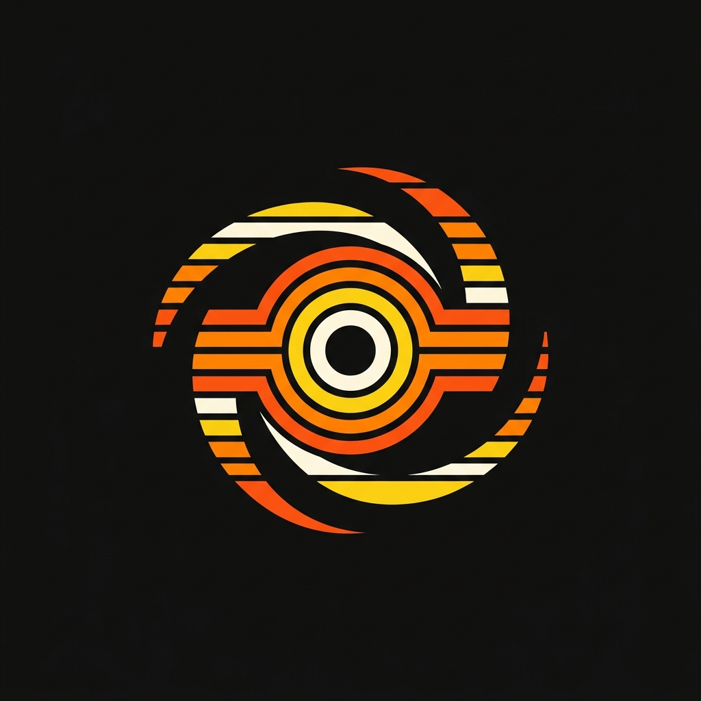

<p align="center">
  
</p>

<h1 align="center">@milky-way/observatory-plugin</h1>

A self-contained React + Three.js WebGL2 plugin package for **Milky Way Observatory** — a continuous multi-scale 3D universe observatory spanning **Earth → Solar System → Nearby Gaia DR3 Stars → Multi-Wavelength Milky Way & Fermi Bubbles → Sagittarius A\* → Local Group & Galaxy Clusters**.

The `plugin/` directory is **completely self-contained**: it has zero Next.js runtime dependencies and zero `@/` path aliases, so it can be embedded directly into any **Next.js**, **Vite + React**, **Remix**, or **Webpack** application.

---

## Included Capabilities

- **Full-Bleed Precision Observatory UI**: Floating top-left instrument strip, bottom telemetry HUD, keyboard-driven **Command Palette** (`/` or `⌘K`), **Cinema Mode (`H`)**, **Telescope Targeting Reticle**, and **Keyboard Shortcuts (`?`)**.
- **Astrophysics Inspection Diagrams**: SVG **Hertzsprung–Russell (H-R) Diagram**, **Planck Blackbody Radiation Spectrum**, and **Interior Cross-Section & Logarithmic Size Comparator**.
- **4-Band Multi-Wavelength Galactic Mode**: Real-time Optical (`OPT`), Infrared (`IR`), Neutral Hydrogen 21 cm Radio (`HI`), and X-Ray / Gamma (`X/γ`) switching with 3D volumetric **Fermi Bubbles**.
- **Real Total Solar Eclipse Shadows & Speed-of-Light Pulse**: Live lunar umbra/penumbra projection onto Earth (`eclipse-2026`, `eclipse-2027`, `eclipse-2024`) and expanding photon wavefront ($c = 299{,}792{,}458\text{ m/s}$).
- **Interactive Scientific Guided Expeditions**: Three choreographed multi-chapter tours (*Powers of Ten*, *The Multi-Wavelength Milky Way*, *Gravity, Shadows & Event Horizons*) localized in 5 languages (`en`, `vi`, `ja`, `zh`, `ko`).
- **HUD-Free WebGL2 PNG Snapshot**: Programmatic and one-click PNG export via `captureSnapshot()`.

---

## Directory Structure

```text
plugin/
├── package.json                      # Package metadata (@milky-way/observatory-plugin)
├── tsconfig.json                     # Standalone TypeScript configuration
├── README.md                         # Integration documentation
├── public/                           # Static star catalog tiles, brand assets & Web Worker
│   ├── logo.jpg                      # Observatory emblem
│   ├── logo.svg                      # Vector observatory mark
│   ├── sunset-hero.jpg               # Editorial catalog hero banner
│   ├── data/
│   │   ├── stars-manifest.json
│   │   ├── stars-tier0.bin
│   │   └── stars-tier1.bin
│   └── workers/
│       └── star-tile-worker.js
└── src/
    ├── index.ts                      # Primary barrel exports
    ├── types.ts                      # MilkyWayPluginProps & MilkyWayPluginHandle
    ├── MilkyWayObservatoryPlugin.tsx # Drop-in React component
    ├── components/                   # Complete UI, Guided Tours, Charts & WebGL2 engine
    └── lib/                          # Float64 scale engine, ephemeris, GLSL shaders, tours, i18n
```

---

## Integration Guide (3 Steps)

### Step 1: Copy `plugin/` & Install Dependencies

Copy the entire `plugin/` directory into your host project (for example `./plugins/milky-way-observatory`), then add the package and runtime dependencies to your host `package.json`:

```json
{
  "dependencies": {
    "@milky-way/observatory-plugin": "file:./plugins/milky-way-observatory",
    "@heroui/react": "^3.2.8",
    "@heroui/styles": "^3.2.8",
    "three": "^0.187.0",
    "astronomy-engine": "^2.1.19",
    "lucide-react": "^1.78.0",
    "motion": "^14.14.0",
    "clsx": "^2.1.1",
    "tailwind-merge": "^3.7.1"
  }
}
```

Then render `<MilkyWayObservatoryPlugin />` directly — **no extra CSS import or Tailwind configuration is required**! The plugin auto-imports its own pre-compiled, container-scoped stylesheet (`observatory-plugin.css`), so it works out of the box in **Next.js, Vite, Remix, Webpack, Electron, or multi-window desktop apps** (whether your host uses Tailwind v4, Tailwind v3, or plain CSS).

> **Multi-Window & Embedded Container Safe:**
> - All Observatory HUD overlays, drawers, catalog grids, and sub-windows (Graphics Settings, Command Palette, World Lab, Shortcuts) use **CSS Container Queries (`@container/root`, `@container/obs`, `@container/modal`)** and **container-scoped modals** (`position: absolute` inside the plugin window), so sub-windows always open inside and above your host window frame without escaping or hiding behind host `z-index` layers.
> - All base resets, variables, and icon-centering rules are strictly scoped to `.mw-observatory-root` / `[data-mw-observatory="true"]` and never alter your host app's global styles.

### Step 2: Copy Star Catalog Tiles & Web Worker into Host `public/`

Copy `plugin/public/data` and `plugin/public/workers` into your host application's `public/` directory:

- **Placed at the root of `public/`** (`public/data/...`, `public/workers/...`) → leave `assetBasePath` empty (default `""`).
- **Placed in a subdirectory** (e.g. `public/observatory/data/...`, `public/observatory/workers/...`) → pass `assetBasePath="/observatory"`.

### Step 3: Mount the Component

#### A. Next.js (App Router)

Add `transpilePackages: ['@milky-way/observatory-plugin', 'motion']` to `next.config.ts`, then render inside a Client Component:

```tsx
'use client';

import { useRef } from 'react';
import {
  MilkyWayObservatoryPlugin,
  type MilkyWayPluginHandle,
} from '@milky-way/observatory-plugin';

export default function ObservatoryPage() {
  const obsRef = useRef<MilkyWayPluginHandle>(null);

  return (
    <div className="w-screen h-screen">
      <MilkyWayObservatoryPlugin
        ref={obsRef}
        initialLanguage="en"
        initialWavelengthBand="optical"
        initialGraphicsTier="rtx"
        assetBasePath=""
        onSelectObject={(id, obj) => {
          console.log('Selected celestial body:', id, obj?.title);
        }}
      />
    </div>
  );
}
```

#### B. Vite + React

```tsx
import { MilkyWayObservatoryPlugin } from './plugins/milky-way-observatory/src';

export function App() {
  return (
    <section style={{ width: '100%', height: '800px' }}>
      <MilkyWayObservatoryPlugin
        initialLanguage="en"
        showTopBar={true}
        showSidebar={false}
        assetBasePath="/observatory"
      />
    </section>
  );
}
```

---

## Props & Imperative `ref` API

| Prop | Type | Default | Description |
| :--- | :--- | :--- | :--- |
| `className` / `style` | `string` / `CSSProperties` | `""` | Container sizing & styling (fills parent `100% × 100%` by default) |
| `initialLanguage` | `'en' \| 'vi' \| 'ja' \| 'zh' \| 'ko'` | `'en'` | Initial UI language (defaults to English) |
| `initialGraphicsTier` | `'potato' \| 'low' \| 'medium' \| 'high' \| 'rtx' \| 'ultra'` | Auto-detect | Optional graphics tier override (`'rtx'` targets RTX 3050–4050 4–8 GB VRAM) |
| `initialTarget` | `string \| null` | `null` | Initial celestial body to inspect (`'earth'`, `'saturn'`, `'star-rigel'`, `'BLACK_HOLE_CORE'`, etc.) |
| `initialWavelengthBand` | `'optical' \| 'infrared' \| 'radio' \| 'xray'` | `'optical'` | Initial Galactic electromagnetic observation band |
| `initialScaleMode` | `'true-1to1' \| 'atlas'` | `'true-1to1'` | Initial astronomical scale mode |
| `initialSidebarOpen` | `boolean` | `false` | Initial expanded state when `showSidebar` is enabled |
| `showTopBar` | `boolean` | `true` | Show or hide the floating instrument strip |
| `showSidebar` | `boolean` | `false` | Show or hide the optional left catalog sidebar (Command Palette `/` is always available) |
| `assetBasePath` | `string` | `""` | Public URL prefix for `data/` and `workers/` assets |
| `summarizeApiUrl` | `string` | `""` | Optional summary endpoint URL (empty uses the built-in offline generator) |
| `persistState` | `boolean` | `true` | Persist language, custom objects, and graphics settings in `localStorage` |
| `storageKeyPrefix` | `string` | `'mw-plugin'` | Prefix for `localStorage` keys to prevent host storage collisions |
| `initialObjects` | `MemoryNode[]` | Built-in catalog | Optional custom initial catalog replacing the default 48 NASA/Gaia objects |
| `onSelectObject` | `(id, obj) => void` | — | Fired when the user selects or clears a celestial object |
| `onLanguageChange` | `(lang) => void` | — | Fired when UI language changes |
| `onGraphicsChange` | `(settings) => void` | — | Fired when graphics settings or preset tier changes |
| `onReady` | `() => void` | — | Fired once the WebGL2 engine completes startup and commits the first frame |

### Imperative Controller Methods (`MilkyWayPluginHandle`)

```ts
obsRef.current?.flyToPreset('milky-way');                // Fly to the Milky Way overview
obsRef.current?.flyToTarget('BLACK_HOLE_CORE');          // Fly directly to Sagittarius A*
obsRef.current?.flyToTarget('star-rigel');               // Fly to Rigel (β Orionis)
obsRef.current?.setWavelengthBand('xray');               // Switch to X-Ray / Gamma + Fermi Bubbles
obsRef.current?.jumpToEclipse('eclipse-2026');           // Jump to 2026-08-12 Total Solar Eclipse
obsRef.current?.triggerPhotonPulse(true);                // Emit Speed-of-Light Photon Pulse (c)
obsRef.current?.setCinemaMode(true);                     // Hide all HUD overlays (Telescope Mode)
obsRef.current?.startTour('multi-wavelength-galaxy');    // Launch an interactive Guided Expedition
obsRef.current?.stopTour();                              // Exit the active Guided Expedition
const png = await obsRef.current?.captureSnapshot();     // Export clean HUD-free WebGL2 PNG data URL
obsRef.current?.setGraphicsTier('rtx');                  // Enable RTX 3050–4050 high-fidelity tier
obsRef.current?.setLanguage('en');                       // Switch UI language programmatically
obsRef.current?.openGraphicsSettings();                  // Open the Graphics & Hardware modal
obsRef.current?.resetCamera();                           // Reset camera view and clear selection
```

---

## Synchronizing the Plugin from the Root Project

Whenever source files in the root application (`components/`, `lib/`, `public/`) are updated, synchronize and validate the standalone plugin package from the repository root:

```bash
npm run sync:plugin
npm run typecheck:plugin
```
